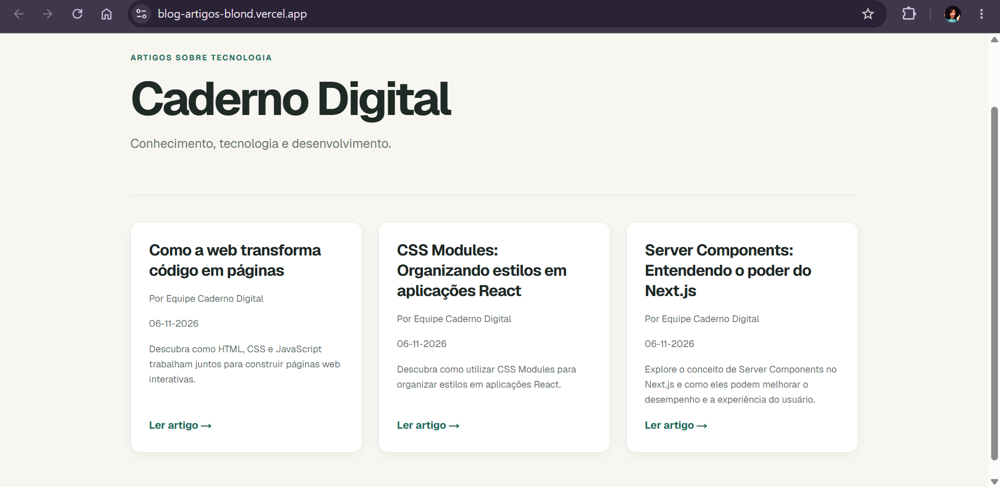
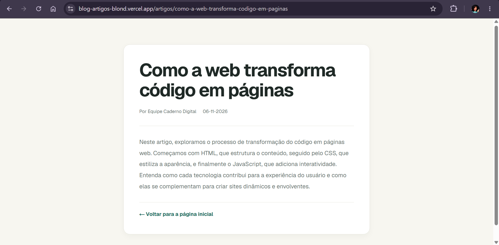
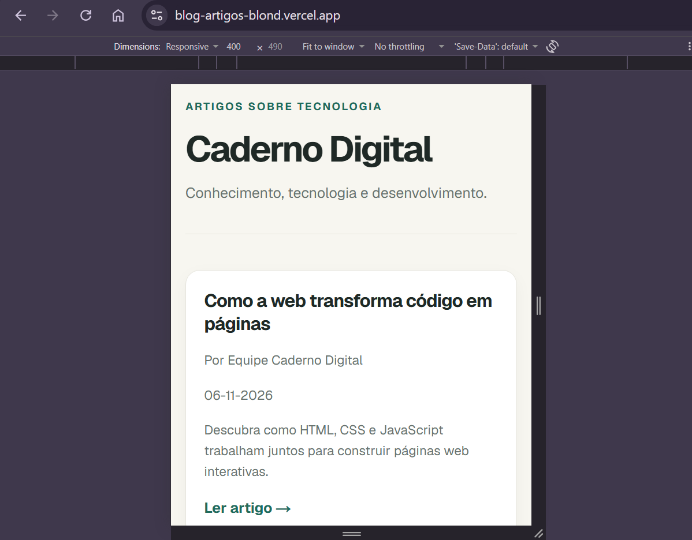

# Caderno Digital

Um blog desenvolvido com Next.js e TypeScript, dedicado a artigos sobre tecnologia, desenvolvimento web, programação e inovação.

O projeto utiliza rotas dinâmicas, Server Components, geração estática de páginas (SSG) e metadados personalizados para SEO.

## 🔗 Acesse o projeto

- **Aplicação publicada:** [Caderno Digital](https://blog-artigos-blond.vercel.app/)

- **Repositório:** [GitHub](https://github.com/aamorah/blog-artigos)

## ✨ Funcionalidades

- Listagem de artigos na página inicial.
- Páginas individuais para cada artigo.
- Rotas dinâmicas utilizando slugs.
- Busca de artigos a partir dos dados locais em JSON.
- Geração estática de páginas com Next.js (SSG).
- Metadados dinâmicos para SEO.
- Layout responsivo para diferentes tamanhos de tela.

## 🛠️ Tecnologias utilizadas

- **Next.js:** framework utilizado para estruturar a aplicação e gerenciar as rotas.
- **React:** biblioteca utilizada para construção da interface.
- **TypeScript:** tipagem estática para maior segurança e organização do código.
- **CSS Modules:** estilização dos componentes e páginas.
- **JSON:** armazenamento local dos dados dos artigos.
- **Git e GitHub:** controle de versão e hospedagem do código-fonte.
- **Vercel:** plataforma utilizada para deploy da aplicação.

## 📁 Estrutura do projeto

```text
blog-artigos/
├── public/
├── src/
│   ├── app/
│   │   ├── artigos/
│   │   │   └── [slug]/
│   │   │       ├── page.tsx
│   │   │       └── page.module.css
│   │   ├── layout.tsx
│   │   ├── page.tsx
│   │   ├── page.module.css
│   │   └── globals.css
│   ├── data/
│   │   └── artigos.json
│   ├── lib/
│   │   └── artigos.ts
│   └── types/
│       └── artigo.ts
├── .gitignore
├── eslint.config.mjs
├── next-env.d.ts
├── next.config.ts
├── package-lock.json
├── package.json
├── README.md
└── tsconfig.json
```

## ⚙️ Como executar o projeto

### Pré-requisitos

- Node.js instalado.
- npm instalado.

### Instalação

1. Clone o repositório:

   ```bash
   git clone https://github.com/aamorah/blog-artigos.git
   ```

2. Acesse a pasta do projeto:

   ```bash
   cd blog-artigos
   ```

3. Instale as dependências:

   ```bash
   npm install
   ```

4. Inicie o servidor de desenvolvimento:

   ```bash
   npm run dev
   ```

5. Acesse no navegador:

   [http://localhost:3000](http://localhost:3000)

## 🖥️ Demonstração

### Página inicial



### Página de artigo



### Versão mobile



## 📚 Aprendizados

Durante o desenvolvimento deste projeto, foram praticados conceitos importantes de desenvolvimento web:

- Utilização do Next.js com App Router.
- Criação de rotas dinâmicas utilizando parâmetros slug.
- Desenvolvimento de Server Components assíncronos.
- Implementação de geração estática de páginas (SSG).
- Utilização de generateStaticParams para pré-renderização de páginas.
- Implementação de metadados dinâmicos para SEO com generateMetadata.
- Organização e tipagem de dados utilizando TypeScript.
- Consumo de dados armazenados localmente em JSON.
- Estilização responsiva com CSS Modules.
- Versionamento de código com Git e publicação com GitHub e Vercel.

## 👩‍💻 Autora

Desenvolvido por **Isabela Soares**, como parte dos estudos práticos em desenvolvimento Front-End e tecnologias web.

- GitHub: [@aamorah](https://github.com/aamorah)
